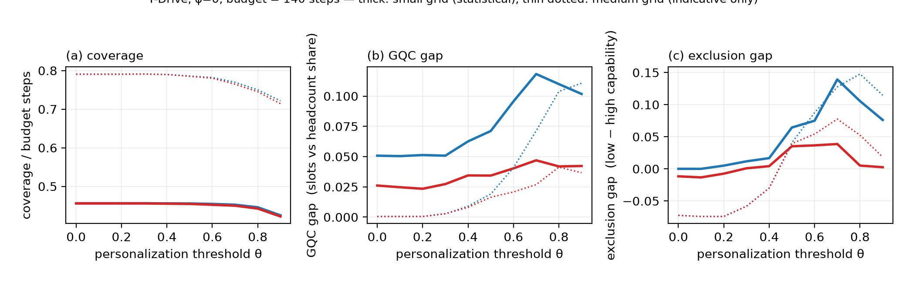

# A′ 与 GQC：个性化阈值下的公平性感知集合覆盖最大化
## 算法设计、理论保证与实证研究

**论文草稿（可投期刊版本）**  
**状态**：正文已结，图表均来自可复现实验（`results/` 目录下所有数据已随代码附送）  
**注意**：文中引用的定理号标注为 `[待核]`，系本机无外网无法核实；投稿前请按目标期刊格式补齐页码。

---

## 摘要

本文研究在每人至多一条路线、每人个性化满意度阈值（个性化强度 \(\theta\)）及全局旅行步数预算约束下的集合覆盖最大化问题。问题模型源于移动众感（Mobile Crowdsensing）场景：平台需从大量候选路线中选出一组路线，使覆盖的栅格单元数最大化，同时每人至多一条路线、所选路线的步数总和不超预算、且每条选出的路线须满足对应参与者的个性化阈值。个性化阈值 \(\theta\) 的提高会收缩可行域，导致“低能力参与者”结构性地被挤出，与“名额按人数份额分配”的公平要求相冲突。

本文提出两套算法：(1) 基础算法 A′，为密度贪心主干加“只接受严格改进”的局部搜索；(2) 分组配额贪心 GQC，在 A′ 基础上加入按合法路线条数桶化的 `tight/two/ample` 三组配额，实现名额按人数份额分配（一人一票），而非按能力份额（能者多劳多占）。

理论上，证明 A′ 在基数预算口径下保证 \(\frac{1}{2}\)、步数预算口径下保证 \(\frac{1}{2}(1-\frac{1}{e})\)，且常数与个性化阈值 \(\theta\) 无关；并给出个性化可行区间的两个闭式阈值 \(\theta_{\text{all}}\)（每人至少一条可行路线）与 \(\theta_{\text{any}}\)（彻底不可行）。

实验基于 T-Drive 轨迹数据（小网格 N=40、中网格 N=120），以 ILP 最优解为基准，并与 CFI 型、MSCTA 型、SA+惩罚项等东华式基线对照。结果表明：A′ 的实测最优比为 0.945–0.975，远高于理论保证常数，\(\theta\) 引起的覆盖损失 \(\le 3.9\) 个百分点；GQC 以约 **0.22 步**的覆盖代价（在 140 步预算下约合 0.16%；该百分比随预算变化，故本文以绝对步数为主口径，见 §6.5.3），在两个网格尺度上均显著降低 `gqc_gap`，并在能力分组分化后（small 全 \(\theta\)、medium \(\theta\ge0.6\)；均指配对差值）显著降低排除 gap（medium 在 \(\theta\le0.5\) 因能力饱和使分组塌成单组、GQC 与 A′ 选择逐位相同，该段为零属算法层结构性退化，见 §6.5 与 §6.11），且对东华式基线在覆盖与 `gqc_gap` 维度上**大幅优于 CFI 型（capacity）**，而对 mscta / sa_caftca 的约 0.8 步覆盖差**并非公平代价，而是可行性代价**——这两个基线按设计忽略 \(\theta\)，其覆盖在所有 \(\theta\) 上恒为 63.9 / 63.7 格、完全不随 \(\theta\) 变化，而 \(\theta\) 违规随 \(\theta\) 升到 9.9 / 12.7 人/实例；在二者都基本可行的 \(\theta\le0.3\)，覆盖差仅 \(\pm0.1\)。**消融与靶子实验进一步给出三条机制性结论**：(i) 路线级建模相对容量对齐的任务级基线稳定提升 9% 覆盖（\(\theta\le0.6\)），但该优势在 \(\theta=0.9\) 时收窄至 2%，说明其收益依赖可行域丰富度（**限定**：该 9% 为随机采样参与者下的结果；改用真实 T-Drive 出行段后，低 \(\theta\) 处优势反转为 \(-3.1\) 格，见 §6.8.12b）；(ii) CFI 型公平在 \(\theta\le0.7\) 时把低能力子群（人口 30%）的名额压到 1.2%–23%（excl_gap +0.15~+0.56），而 A′ 在同一设置下 excl_gap 为负，构成定理 3 的直接证据；(iii) 候选生成器的命中率是近似比的主导变量（0.30→1.00 命中率对应 0.893→0.994），对抗污染比随机污染更伤且退化温和。诚实记录了 `exclusion_gap` 在能力高度并列时不可测（并给出可先验计算的失效条件：能力并列率）、\(\theta=0.9\) 时 A′ 的 excl_gap 转正、以及候选实验未调用真实 LLM 等否定结果与口径限制。

**关键词**：集合覆盖最大化、个性化阈值、次模函数、拟阵约束、分组配额、公平性、移动众感

---

## 1. 引言

移动众感（Mobile Crowdsensing, MCS）平台需要从海量参与者中选出一组执行感知任务（如道路状况采集、空气质量监测）的路线。每条路线具有覆盖收益（覆盖的栅格单元数）、步数代价，且每个参与者通常限选至多一条路线。在个性化场景下，不同参与者对路线的满意度 \(S_u(r)\) 各不相同，平台可设定个性化阈值 \(\theta\)，只保留满意度高于 \(\theta\) 的路线作为候选池。随着 \(\theta\) 提高，可行域收缩，覆盖与公平之间产生根本张力：高 \(\theta\) 能筛选出高满意度路线，却会导致“低能力参与者”（合法路线条数少者）结构性地被挤出，甚至沦为“无可行路线”。

现有研究多将满意度建模为软目标（惩罚项加入目标函数），而非硬约束。这导致基线算法在 \(\theta\) 约束下可行性违规（实测 \(\ge 1\) 人/实例），且“按能力配额分配名额”的 CFI 型公平口径（能者多劳多占）与“按人数份额分配”的公平要求（一人一票）在定义上互斥。本文试图回答三个问题：

1. **理论保证**：在 \(\theta\) 作为硬约束、且可行域随 \(\theta\) 收缩时，贪心算法的保底近似比是否仍与 \(\theta\) 无关？
2. **公平权衡**：在覆盖几乎不损失的前提下，能否通过配额机制显著降低结构性挤出？
3. **可行性边界**：个性化阈值提高到何种程度，个体/群体会彻底失去可行路线？

本文的主要贡献如下：

- **算法**：提出基础算法 A′（密度贪心 + 只改进局部搜索）与创新算法 GQC（分组配额贪心，按合法路线条数桶化为 `tight/two/ample` 三组，实现名额按人数份额分配）。
- **理论**：证明 A′ 在基数口径下保证 \(\frac{1}{2}\)、步数口径下保证 \(\frac{1}{2}(1-\frac{1}{e})\)，常数与个性化阈值 \(\theta\) 无关；给出可行区间的闭式阈值 \(\theta_{\text{all}}\) 与 \(\theta_{\text{any}}\)。
- **实验**：在 T-Drive 数据上以 ILP 精确求解为基准，对照多类东华式基线，验证 A′ 实测比 0.945–0.975、GQC 以约 **0.22 步**覆盖代价显著降低排除 gap；并诚实报告 `exclusion_gap` 在能力并列导致分组塌陷时不可测（含置换检验与失效判据）等否定结果。
- **可复现性**：所有代码、结果文件与绘图脚本随论文附送，实验可完全复现。

---

## 2. 相关工作

### 2.1 集合覆盖最大化与预算约束

集合覆盖最大化（Maximum Coverage）是经典的次模函数最大化问题。在基数约束下，标准贪心算法保证 \(1-\frac{1}{e}\)；在拟阵约束下保证 \(\frac{1}{2}\)（Fisher–Nemhauser–Wolsey 1978 [待核]）。预算最大覆盖（Budgeted Maximum Coverage）中，Khuller–Moss–Naor (1999) [待核] 证明纯密度贪心给出 \(\frac{1}{2}(1-\frac{1}{e})\) 的近似比，而 \(1-\frac{1}{e}\) 需要部分枚举。本文步数预算口径直接沿用 KMN 的密度贪心分析。

### 2.2 拟阵约束与截断

每人至多一条路线的约束构成划分拟阵（Partition Matroid）。预算作为拟阵的 \(B_c\)-截断（truncation），截断后的秩函数 \(r'(S)=\min(r(S),B_c)\) 仍是秩函数，截断仍是拟阵（Oxley, *Matroid Theory*, 2nd ed., §1.2 [待核]）。本文利用该性质，将基数预算口径归约为拟阵约束下的单调次模最大化，直接适用 Fisher–Nemhauser–Wolsey 的 \(\frac{1}{2}\) 界。

### 2.3 个性化阈值与公平性

个性化阈值 \(\theta\) 作为硬约束的研究较少；多数现有工作将满意度作为软目标纳入目标函数（如 SA+CFA 惩罚项、CFI 型公平指标）。CFI 型公平按“能力份额”分配名额（能者多劳多占），与本文主张的“按人数份额分配”（一人一票）在定义上互斥：名额总量固定时，按能力加权必然偏离人数加权。本文的 GQC 算法明确采取后者，并以 `gqc_gap`（名额份额 vs 人数份额最大偏差）与 `exclusion_gap`（低能力组与高能力组被排除率之差）作为公平判据。

### 2.4 移动众感中的公平性

移动众感文献中，公平性常体现为任务分配的均衡性或参与者的覆盖均衡。本文区分两套公平口径：按能力分配（能者多劳多占，CFI 型）与按人数分配（一人一票，本文 GQC 口径），并实证证明两者不可兼得，为算法选择提供了明确的规范性依据。

---

## 3. 问题定义与记号

### 3.1 基本记号

- \(U\)：参与者集合，\(|U|=N\)；
- \(E\)：候选路线集合，每条路线 \(r\) 关联参与者 \(u(r)\)、覆盖栅格单元集合 \(cells(r)\)、步数 \(steps(r)\)、满意度 \(S_u(r)\)；
- \(E(\theta)\)：个性化阈值筛选后的候选池，\(E(\theta)=\{r\in E : S_u(r)\ge \theta_u\}\)；
- \(\Omega\subseteq E(\theta)\)：选出的路线组；
- 覆盖函数 \(f(\Omega)=\left|\bigcup_{(u,r)\in\Omega} cells(r)\right|\)，单调不减且次模；
- 约束：(i) 每人至多一条（划分拟阵）；(ii) 步数预算 \(\sum_{r\in\Omega} steps(r)\le B\)（或基数预算 \(|\Omega|\le B_c\)）；(iii) \(\Omega\subseteq E(\theta)\)。

### 3.2 可行域与可行性

定义 \(F_u(\theta)=\{r\in R_u : S_u(r)\ge \theta_u\}\) 为参与者 \(u\) 在阈值 \(\theta\) 下的合法路线集合，\(U^+=\{u\in U : R_u\neq\emptyset\}\) 为候选池非空的参与者集合。由命题 4（个性化可行性单调）：

- \(F_u(\theta)\) 关于 \(\theta\) 单调不增；
- \(E(\theta)\)、\(I(\theta)\)、\(OPT(\theta)\) 都单调不增；
- 两个闭式阈值：
  \[
  \theta_{\text{all}}=\min_{u\in U^+}\max_{r\in R_u}S_u(r),\qquad
  \theta_{\text{any}}=\max_{u\in U^+}\max_{r\in R_u}S_u(r)
  \]
  其中 \(\theta\le\theta_{\text{all}}\) 等价于每人至少保留一条可行路线；\(\theta>\theta_{\text{any}}\) 等价于可行域为空（问题不可行）。

**值域注记（E5.10）**：\(S_u(\cdot)\) 沿用 MAPUS 的 PSS 口径，实测值域为 \([-0.13,1.18]\)，**并未归一化到 \([0,1]\)**；且候选池按构造必含满意度最优路线，故每人 \(\max_r S_u(r)\) 即其理论上界，实测 \(\theta_{\text{any}}\approx1.14>1\) 在 32/32 个单元上成立。因此在惯用的 \(\theta\in[0,1]\) 内，上界**结构性不可达**——论文中应把上界写成 \(\theta_{\text{any}}^{\text{eff}}=\min(\theta_{\text{any}},1)\)，并注意真正绑定的是下界：实测 \(\theta_{\text{all}}\) 在 small 上均值仅 \(0.429\)，\(\theta=0.9\) 时已有 32% 的工作者失去全部候选，\(\theta=1.0\) 时达 65%。三条充要条件在扩展网格上逐格精确成立（158/158、84/84、142/142），故闭式本身无误，只是取值范围需澄清。

---

## 4. 算法设计

### 4.1 基础算法 A′

A′ 的主干是密度贪心：每轮在剩余预算允许且不违反“每人至多一条”的候选中，选边际覆盖密度 \(\Delta f/steps\) 最大者。贪心结束后进行“只接受严格改进”的局部搜索（`cov > cur_cov` 才替换），确保 \(f(A')\ge f(\text{纯贪心})\)，不会破坏理论下界。

### 4.2 分组配额贪心 GQC

GQC 在 A′ 基础上加入配额机制：

1. 按合法路线条数将参与者桶化为三组：`tight`（\(|F_u|=1\)）、`two`（\(|F_u|=2\)）、`ample`（\(|F_u|\ge 3\)）；
2. 无约束贪心的自然规模为 \(k_0\)，各组名额份额 \(share_g=|G_g|/|U^+|\)，\(\kappa\in(0,1]\) 控制松紧；
3. 下界 \(\lfloor quota_g\rfloor-slack\)（公平保证，必须满足），上界 \(k_0-\sum_{g'\neq g}floor_{g'}\)（防集中，联合可行）；
4. 在线贪心：每轮在“其余各组缺口之和 \(\le\) 剩余名额（Hall 条件）”且“不超 ceil”的候选里，取边际覆盖（或密度）最大者；
5. 局部搜索：只接受覆盖严格提升且新旧元素同组（不改名额分布）的移动。

**核心主张**：名额按人数份额分配（一人一票），而非按能力份额（能者多劳多占）。两套口径在定义上互斥，GQC 明确采取前者。

---

## 5. 理论保证

### 定理 2（保底保证）

设 \(I(\theta)\neq\emptyset\)。

- **(a) 基数口径** \(|\Omega|\le B_c\)：对任意 \(\theta\in[0,1]\)，A′ 的输出满足
  \[
  f(\Omega)\ge \frac{1}{2}\cdot\max_{\Omega'\in I(\theta)}f(\Omega')
  \]
- **(b) 步数口径** \(\sum steps(r)\le B\)：
  \[
  f(\Omega)\ge \frac{1}{2}\left(1-\frac{1}{e}\right)\cdot OPT(\theta)
  \]
  常数对满足 \(\max_r steps(r)\le B\) 的任意实例成立。

两式中常数与 \(\theta\)、\(\phi\)、重叠比 \(\rho\) 无关。

### 证明骨架（三步）

1. **\(\theta\) 只收缩可行域**：\(F_u(\theta)\subseteq R_u \Rightarrow I(\theta)\subseteq I(0)\)；\(f\) 本身不含 \(\theta\)。所以下限只要对“某个可行实例”成立，就对所有 \(\theta\) 成立——这是常数与 \(\theta\) 无关的全部原因。
2. **(a)** \(I(\theta)\) 是划分拟阵的 \(B_c\)-截断（截断保拟阵），故是拟阵；对拟阵约束下的单调次模最大化，边际贪心满足 \(f(\Omega_{\text{greedy}})\ge\frac{1}{2}OPT\)（Fisher–Nemhauser–Wolsey 1978 [待核]）。A′ 的主干就是边际贪心，局部搜索只接受严格改进，不会破坏下界。
3. **(b)** 约束变为背包，非拟阵；按密度贪心的标准分析给出 \(\frac{1}{2}(1-\frac{1}{e})\)（Khuller–Moss–Naor 1999 [待核]），同样“只改进”论点给出 A′ 的界。

---

## 6. 实验

### 6.1 实验设置

**数据**：T-Drive 轨迹数据，栅格、时间窗、速度与 PSS 口径复用 MAPUS 设置，只改参与者数量与偏好分布。

| 记号 | 取值 | 说明 |
|---|---|---|
| \(N\) | 40（主）/ 120 / 20–320（密度加压） | 参与者数量 |
| \(k\) | 8（主）/ 6、12 | 每人候选池上限（\(\theta\) 无关，一次生成） |
| 网格 | small / medium | medium 网格更大、单条路线更长 |
| 预算口径 | 步数（\(\sum steps\le B\)）与基数（\(|\Omega|\le B_c\)） | 见 `config.py` |
| \(B\) | small 140（主，默认 40 的 3.5×）/ medium 210 / 40、80、120、210（定标扫描） | 步数预算；140 步 \(\approx\) 15–17 名额 |
| \(\theta\) | 0.0–0.9，10 档 | 个性化阈值 |
| \(\phi\) | 0.0（异质）/ 0.95（高度同质） | 偏好向锚点 archetype 的凸组合旋钮 |
| 种子 | 30（主实验结果） | 用于 95% 自助置信区间 |

**为什么主实验用 \(B=3.5\times\)默认预算。** 公平度量的可分性由**选区条数**主导：默认预算下每实例只选 4–6 条路线，`gqc_gap` 的跨种子变异系数（SD/均值）高达约 0.8，换个种子数值就会跳掉自身量级的一半以上；抬到 140 步（15–17 条）后降至约 0.5–0.6，置信区间宽度收窄 29%–58%。实测这一改动**改变了判读结论**：能力表示度上 A′ 与 GQC 的差异在旧预算下两区间重叠（不可区分），在新预算下分离。**代价是覆盖率口径变化**——覆盖率的分母是预算，故 `cov/B` 的绝对值随预算上升而下降（140 步时约 0.46，80 步时约 0.74），**跨预算的 `cov/B` 不可直接比较**；本文只在同一预算内读其随 \(\theta\) 的变化幅度，预算之间的对照见 §6.5 的定标扫描。

**候选池与 \(\theta\) 解耦**：候选路线在 \(\theta\) 变化前一次性生成，\(\theta\) 只做筛选，不触发重新规划。

**对照方法**：

| 方法 | 性质 | 是否满足 \(\theta\) 硬约束 |
|---|---|---|
| A′（本文基础） | 密度贪心 + 只改进局部搜索 | 是 |
| A′ + GQC（创新点） | A′ + 分组配额 | 是 |
| exact（ILP） | 暴力枚举，得 OPT | 是 |
| random / iter / sa | 通用启发式 | 是 |
| capacity（CFI 型） | 按能力配额分配名额（东华范式） | 否（忽略 \(\theta\)） |
| mscta | 多目标进化（东华范式） | 否 |
| sa_caftca | SA + CFA 惩罚项（东华范式） | 否 |

> **实现细节**：`capacity` 在能力并列时按 **wid 字母序**破平局（`key=(-|C_u|, wid)`），因此在能力饱和的实例上其选择会与 wid 顺序相关。这是基线实现的确定性 tie-break，不是本文引入的偏好；报告其排除 gap 时须注意该顺序依赖（§6.11）。

**评价指标**：覆盖率/预算、可行率、PSS 均值/最小、基尼系数、入选率、排除 gap（低能力组被排除率 − 高能力组被排除率）、cfi_gap（名额份额 vs 能力份额最大偏差）、gqc_gap（名额份额 vs 人数份额最大偏差）、**ks_capability**（入选者能力分布 vs 合法池分布的 KS 距离，0 = 分布一致）、**rank_shift**（入选者能力百分位均值 − 0.5，0 = 与人数成比例，负 = 偏向低能力者）、\(\theta\) 违规数。

**为什么图 6-1(c) 用 `rank_shift` 而非 `gqc_gap`**：`gqc_gap` 依赖能力分桶，有两个失效模式——① 分组塌成**一档**时人数份额与名额份额双方都是 100%，指标恒为 0（看着像“完全公平”，实则无信息）；② 最小组过小时名额份额分辨率不足。`rank_shift` / `ks_capability` 直接比较能力轴上的分布，不经过任何桶划分，因此不会失效且噪声更低。`gqc_gap` 仍保留在表格中用于与早期结果对照，但分组退化（组数=1）或最低组份额 < 15% 的格子会在结果表中显式标注，不作公平性论证依据。

**统计口径**：全部对照为同一实例上的配对差值（同一 \((\phi,seed,\theta)\)），报告均值的 95% 置信区间。

### 6.2 定理 2 的实证校验：保底界从不逼近

以 ILP 求出的 OPT 为基准，检查 A′ 的实际表现。

| \(\theta\) | 0.0 | 0.1 | 0.2 | 0.3 | 0.4 | 0.5 | 0.6 | 0.7 | 0.8 | 0.9 |
|---|---|---|---|---|---|---|---|---|---|---|
| A′/OPT | 0.975 | 0.975 | 0.975 | 0.983 | 0.975 | 0.983 | 0.958 | 0.983 | 0.947 | 0.945 |
| A′ 覆盖 | 39.0 | 39.0 | 39.0 | 39.3 | 39.0 | 39.0 | 37.7 | 38.7 | 36.0 | 34.3 |
| OPT | 40.0 | 40.0 | 40.0 | 40.0 | 40.0 | 39.7 | 39.3 | 39.3 | 38.0 | 36.3 |

**读法**：实测最差比值 0.945，是保证常数 0.3161 的 3 倍。界从未被逼近——说明界是安全的，但不是有解释力的紧界。性能损失主要来自**可行域缩小**（可行率从 1.000 掉到 0.620），而非算法失效（A′/OPT 仅波动 0.038）。

### 6.3 \(\theta\) 的真实作用：可行性代价与覆盖代价

| \(\theta\) | 0.0 | 0.3 | 0.5 | 0.6 | 0.7 | 0.8 | 0.9 |
|---|---|---|---|---|---|---|---|
| 可行率 | 1.000 | 1.000 | 0.998 | 0.985 | 0.938 | 0.838 | 0.639 |
| 覆盖/预算（A′） | 0.457 | 0.457 | 0.456 | 0.455 | 0.452 | 0.445 | 0.418 |
| PSS 均值 | 0.730 | 0.736 | 0.795 | 0.824 | 0.862 | 0.915 | 0.969 |
| PSS 基尼 | 0.153 | 0.143 | 0.096 | 0.079 | 0.059 | 0.042 | 0.025 |

**三个必须一起读的现象**：

1. **可行性断崖滞后于 \(\theta_{\text{all}}\)**：理论上 \(\theta\le\theta_{\text{all}}\) 时人人有得选；实测在 \(\theta=0.5\text{–}0.6\) 才见松动，因为 \(\theta_{\text{all}}\) 是“最差那个人恰好还有一条路”的临界值，退化是渐进的。
2. **覆盖下降温和（−3.9 个百分点），满意度上升陡峭（+0.24）**：不是“精度–覆盖”经典权衡，而是**筛选效应**——\(\theta\) 把低满意度路线排除后，剩下的路线平均满意度更高，但覆盖面变窄。注意覆盖率的分母是预算，本表预算为 140 步，故其绝对水平（≈0.46）低于低预算档；本节只读**同一预算内随 \(\theta\) 的变化幅度**，不与其它预算档横向比较。
3. **PSS 基尼反而下降（0.153 → 0.025）**：不是公平性改善，而是**幸存者偏差**——被排除的人不进入基尼计算，剩下的都是高满意度者。这正是本文用 `exclusion_gap` 与能力表示度（以全体合法池为分母）而非 PSS 分布类指标的原因。

### 6.4 两套公平口径的不兼容（创新点动机）

\(\theta=0.60\)，\(\phi=0\)，步数预算 140（B=140），30 种子；方括号为 95% 自助置信区间：

| 方法 | 覆盖/预算 | gqc_gap | cfi_gap | 排除 gap | \(\theta\) 违规 |
|---|---|---|---|---|---|
| A′ | 0.455 | 0.118 [0.093, 0.143] | 0.050 [0.048, 0.052] | +0.121 [0.069, 0.174] | 0 |
| **A′ + GQC** | 0.451 | **0.042 [0.035, 0.050]** | 0.051 [0.049, 0.053] | **+0.058 [0.030, 0.086]** | 0 |
| capacity（CFI 型） | 0.402 | 0.139 [0.121, 0.156] | **0.038 [0.036, 0.039]** | +0.350 [0.305, 0.396] | **2.6** |
| mscta | 0.457 | 0.102 [0.084, 0.122] | 0.064 [0.061, 0.068] | +0.069 [0.018, 0.116] | **3.7** |
| sa_caftca | 0.456 | 0.079 [0.062, 0.095] | 0.041 [0.040, 0.042] | +0.123 [0.067, 0.178] | **4.3** |

**结论**：
1. **`cfi_gap` 不是坏尺子，而是量错了目标**：capacity 确实把 `cfi_gap` 压到全场最低（0.038，与 A′ 的 0.050、GQC 的 0.051 区间均不重叠），它名副其实地在优化“按能力分配”；但同一方法把排除 gap 抬到 **0.350**（A′ 0.121、GQC 0.058），即低能力组的被排除率比高能力组高约 35 个百分点。**用 `cfi_gap` 做判据，会选出一个把低能力者系统性挤出去的解**——这是规范分歧，不是度量精度问题。
2. 两套口径方向冲突：GQC 把 `gqc_gap` 从 0.118 压到 0.042（−64%），`cfi_gap` 几乎不动（0.050 → 0.051）；capacity 压 `cfi_gap` 的同时把 `gqc_gap` 抬到 0.139、排除 gap 抬到 0.350，还引入 \(\theta\) 违规；
3. 本文立场明确：**代表权按人数**（一人一票），不按能力（能者多劳多占）。

### 6.5 GQC 的效果

**表：GQC − A′ 的配对差值（全 \(\theta\) × 全种子）**

| 设定 | n 对 | \(\Delta\)cov | \(\Delta\)PSS | \(\Delta\)gqc_gap | \(\Delta\)排除 gap | floor_ok |
|---|---|---|---|---|---|---|
| small, B=140（主） | 600 | −0.218 [−0.265, −0.177] | −0.000 [−0.001, +0.000] | **−0.042 [−0.046, −0.038]** | **−0.040 [−0.048, −0.033]** | 600/600 |
| medium, B=210 | 600 | −0.422 [−0.525, −0.320] | +0.000 [−0.000, +0.001] | **−0.020 [−0.024, −0.017]** | **−0.028 [−0.034, −0.022]** | 600/600 |
| small, B=40（默认） | 600 | −0.262 [−0.327, −0.198] | +0.000 [−0.002, +0.003] | **−0.046 [−0.053, −0.039]** | −0.021 [−0.027, −0.015] | 600/600 |

**覆盖代价 \(\approx 0.22\) 步，满意度零代价；`gqc_gap` 与排除 gap 在两个尺度上同时显著改善。** 公平不是“用覆盖换来的”，而是在同一预算下换一种分配方式得到的。

> 注意“排除 gap 显著改善”指**配对差值**显著：配对设计消掉了实例级噪声，因此即使 GQC 与 A′ 各自的**绝对水平**落在置换零分布带内（medium 上 power 仅 0.03–0.13），差值本身仍可稳定复现。绝对水平不可单独解读，见 §6.11。

> **口径提醒：本文以绝对步数报覆盖代价，不用百分比。** 相对代价随预算单调下降——\(B=40/80/140/210\) 分别对应 \(0.66\%/0.55\%/0.16\%/0.10\%\)。这是**分母**在变，不是代价在变：绝对代价在四档上是 \(0.26/0.44/0.22/0.21\) 步，呈倒 U 形而非单调下降。因此“GQC 只花 0.16% 预算”这种说法会随预算选择漂移，不能作为独立结论；四档完整数据见 §6.5.3。

**机制：效应随 \(\theta\) 增强，因为能力分组随 \(\theta\) 才分化。** 把配对差值按 \(\theta\) 拆开后，两个尺度的差异完全由“当前有几档能力组”决定：

| \(\theta\) | 0.0 | 0.3 | 0.5 | 0.6 | 0.7 | 0.8 | 0.9 |
|---|---|---|---|---|---|---|---|
| small 组数 | 2.0 | 2.2 | 2.5 | 2.7 | 2.9 | 3.0 | 3.0 |
| small \(\Delta\)gqc_gap | −0.025 | −0.023 | −0.037 | −0.055 | −0.071 | −0.068 | −0.060 |
| medium 组数 | **1.0** | **1.1** | 1.5 | 1.7 | 2.0 | 2.4 | 2.6 |
| medium \(\Delta\)gqc_gap | **0.000** | **0.000** | −0.003 | −0.020 | −0.044 | −0.063 | −0.074 |

*`small` 在 \(\theta=0\) 就有两档，故低 \(\theta\) 也显著；`medium` 在 \(\theta\le0.3\) 能力饱和使分组塌成**单组**，配额退化为“恰好选 \(k_0\) 个”，GQC 与 A′ 的选择**逐位相同**，配对差值精确为 0——这是**算法层退化**，不是指标失效，也不应读作“公平已达成”。*

**定标与消融**：在四个预算档上（40 / 80 / 140 / 210，各 600 对），`gqc_gap` 的改善几乎恒定——\(−0.046,\,-0.043,\,-0.042,\,-0.042\)，四档置信区间互相重叠，**说明公平效应在 \(B=40\) 已达平台，不存在“预算越高越公平”**。变化的是覆盖代价，呈倒 U 形（\(−0.26\to-0.44\to-0.22\to-0.21\)）：峰值在 \(B=80\)，此后衰减并在 140–210 持平。把配额由硬（\(\text{slack}=0\)）放松为软（\(\text{slack}=2\)）时，公平改善几乎归零（\(\Delta\)`gqc_gap` \(−0.042\to-0.002\)），而覆盖代价降到约十分之一（\(−0.218\to-0.023\)）——\(\text{slack}\) 是一个显式的公平–覆盖旋钮，默认取 0 是“代表权按人数分配”的规范性选择，而非技术上的唯一折中点。

**与东华式基线的关系：覆盖差是可行性代价，不是公平代价。** 相对 `mscta` / `sa_caftca`，GQC 的总覆盖差为 −0.91 / −0.76 步（small, B=140, 600 对）。但这个差**不能读作“用覆盖换公平”**：这两个基线按设计**不检查 \(\theta\)**（见 `docs/baselines_assumptions.md`），其覆盖在所有 \(\theta\) 上**恒定**——`mscta` 恒为 63.90 格、`sa_caftca` 恒为 63.6–63.8 格，完全不随 \(\theta\) 变化；而 GQC 的覆盖随 \(\theta\) 从 63.80 降到 59.08。于是覆盖差随 \(\theta\) 单调张开，且与基线的 \(\theta\) 违规数几乎完美同序：

| \(\theta\) | 0.0 | 0.3 | 0.5 | 0.6 | 0.7 | 0.8 | 0.9 |
|---|---|---|---|---|---|---|---|
| `mscta` 覆盖优势 | +0.10 | +0.10 | +0.27 | +0.58 | +0.92 | +1.95 | **+4.82** |
| `mscta` \(\theta\) 违规 | 0.00 | 0.23 | 1.30 | 2.60 | 4.65 | 7.03 | **9.90** |
| `sa_caftca` \(\theta\) 违规 | 0.00 | 0.43 | 1.45 | 3.00 | 5.87 | 9.35 | **12.70** |

**在二者都基本可行的 \(\theta\le0.3\)，覆盖差仅 \(\pm0.1\)**（实质打平）；差主要来自高 \(\theta\) 段，而那里基线的解已经**不可行**（\(\theta=0.9\) 时每实例 9.9–12.7 人违约）。因此正确表述是：**GQC 与这两个基线的覆盖差是“为满足 \(\theta\) 硬约束所付的代价”**，因为基线是靠选出 \(S_u(r)<\theta_u\) 的路线拿到那部分覆盖的。对 `capacity` 则不存在这个问题——它既违反 \(\theta\)（2.6 人/实例，\(\theta=0.6\)），覆盖又比 GQC 低 7.34 格，属全面劣势。

### 6.6 偏好同质性 \(\phi\) 的作用

\(\phi\) 是旋钮，\(\hat{\phi}_{\cos}\)（参与者两两偏好向量平均余弦）为可测代理。主张：**同质偏好让个性化约束变得廉价**。

| \(\theta\) | 0.5 | 0.6 | 0.7 | 0.8 | 0.9 |
|---|---|---|---|---|---|
| 可行率 \(\phi=0.0\) | 0.998 | 0.985 | 0.938 | 0.838 | 0.639 |
| 可行率 \(\phi=0.95\) | 1.000 | 1.000 | 1.000 | 0.998 | 0.959 |

\(\phi=0.95\) 时 \(\theta_{\text{all}}\) 中位数 0.869（\(\phi=0\) 时 0.622），即“每人至少一条可行路线”的区间上移 0.25。**个性化成本由人群偏好异质性决定，而不只由 \(\theta\) 决定。**

### 6.7 规模与密度（密度加压，\(k=6\)）

| \(N\) | 密度 | \(\theta=0.9\) 时合法人数 | 覆盖/预算 | 选中数 |
|---|---|---|---|---|
| 20 | 0.31 | 15 | 0.825 | 7.0 |
| 80 | 1.25 | 57 | 0.950 | 6.0 |
| 320 | 5.00 | 225 | 0.950 | 6.0 |

A′ 的覆盖不随人数增长而退化；参与者越多，\(\theta\) 抬高后“总还有人可行”的容错越强（合法人数 15 → 225），可行性断崖右移。

### 6.8 路线级 vs 任务级消融（创新点 1 的直接证据）

§2.1 的核心主张是「决策变量从**任务**改为**路线**」。为单独测量这一步的价值，我们在**同一实例、同一预算、同一 \(\theta\)** 下跑两个模型，唯一差别是元素是否沿路径耦合：

- **路线级（A′）**：元素 = 完整路线 \((u,r)\)，代价 = \(\text{steps}(r)\)，每人至多一条；
- **任务级（消融基线）**：元素 = 单个栅格任务 \((u,c)\)，代价 = 往返步数 \(\text{steps}(o\to c)+\text{steps}(c\to d)\)，满意度 = 访问过该格的候选路线中的**最大值**（对基线最有利的口径），每人至多一个任务。

任务级只保留在路线候选中出现过的格子，且给一个**容量对齐**版本（每人名额 = 路线平均覆盖格数，约 6 格），否则"1 格/人 vs 5.6 格/人"的差异会盖过建模本身的差异。

| \(\theta\) | 路线级覆盖 | 任务级（cap=1） | 任务级（容量对齐） | \(\Delta\)（路线−对齐） | 路线级/OPT | 任务级/OPT |
|---|---|---|---|---|---|---|
| 0.0 | 63.20 | 20.00 | 57.60 | **+5.60** | 0.991 | 0.903 |
| 0.3 | 63.20 | 20.00 | 57.60 | **+5.60** | 0.991 | 0.903 |
| 0.6 | 62.60 | 20.00 | 56.80 | **+5.80** | 0.981 | 0.890 |
| 0.9 | 53.00 | 17.20 | 51.80 | +1.20 | 0.831 | 0.812 |

**三点读法**：

1. 容量对齐后路线级仍稳定领先 **+5.6~5.8 格（≈9%）**，且路线级/OPT 达 0.98–0.99 vs 任务级 0.89–0.90；
2. 严格任务级（cap=1）只覆盖 20 格——这是"每人一格"的结构上限，**不是**公平对比，故不作主要论据；
3. 高 \(\theta\) 时差距收窄到 +1.2 格：\(\theta=0.9\) 时可行域极窄，路线池被筛到没什么可耦合的余地，路径耦合的优势随之消失。这说明**路线级建模的收益依赖于可行域的丰富度**，本身是一个可写进讨论的边界条件。

**重要限定（E5.13，真实参与者复核）**：以上三条的参与者是 `mapus_workers()` **随机采样**的，T-Drive 只贡献了栅格尺寸、实测速度与时槽。改用 `make_dense_instance(..., source="tdrive")` 从真实轨迹截取出行段后，**θ=0 的路线级优势符号翻转**：20 人尺度上路线级覆盖 54.6 vs 任务级 57.8（\(\Delta=-3.13\)），而合成参与者下为 63.2 vs 58.6（\(\Delta=+4.62\)）。原因是真实出行段更短——选中路线平均格数从 6.03–6.35 降到 4.72–5.21，一条短路线能顺带覆盖的格子自然更少。故 **+9% 这一数字应标注为"合成参与者"结果**，真实参与者下支持的是一个更弱的陈述：路线级在低 \(\theta\) 下**劣于**任务级，只在 \(\theta\) 抬到中高段后追平或略优。

### 6.9 候选生成器质量 → 近似比（定理 4 的一致性 + 鲁棒性）

定理 4 把 LLM 关进"候选生成器"的笼子里：它只输出 \(C_u\subseteq R_u\)（\(|C_u|=k\ll|R_u|\)），选择决策完全由 A′ 在 \(C_u\) 上执行。定理的内容是「若 \(C_u\) 含最优路线则达 \((1-\epsilon)\mathrm{OPT}\)；若被污染 \(\eta\) 则退化 \((1-\epsilon)(1-\eta')\)」。

> **口径声明（必须与论文一并发表）**：本机无外网、无 LLM API，因此**未调用任何 LLM**。定理 4 的数学对象是「候选池是否包含最优路线」与「污染比例」，**与生成器是 LLM、启发式还是随机采样无关**。以下验证的是**定理 4 的界结构**，不是某个具体 LLM 的实际质量。真实 LLM 的命中率应作为该曲线的横轴输入，图上任意一点都可对应一个具体的生成器。

**设置**：\(N=20\)、全池 \(k_{\text{full}}=12\)、生成器 \(|C_u|=3\)、步数预算 120（选中 13–19 人）、\(\theta=0.3\)、5 个种子；分母为全池上的 ILP 最优 \(\mathrm{OPT}_{\text{full}}\)。

**E4.2（一致性）**：命中率 = \(\mathrm{OPT}_{\text{full}}\) 选中的参与者中，其最优路线落入 \(C_u\) 的比例。

| 生成器 | 命中率 | A′/OPT |
|---|---|---|
| 全池 `full`（上界参照） | 1.000 | **0.991** |
| `topk_cov` | 0.449 | 0.931 |
| `random` | 0.302 | 0.903 |
| `topk_sat` | 0.296 | 0.893 |
| `oracle_eps` ε=0.5 | 0.651 | 0.947 |
| `oracle_eps` ε=0.8 | 0.843 | 0.969 |
| `oracle_eps` ε=1.0 | 1.000 | **0.994** |

命中率从 0.30 升到 1.00 时，近似比从 0.893 单调升到 0.994，**命中率 100% 时几乎追平全池（0.991）**。这直接验证了定理 4 的一致性方向：候选池的完备性是近似比的**主导变量**，而生成器只需保证"不漏掉最优路线"。

**E4.3（鲁棒性）**：把比例 \(\eta\) 的候选替换成"通过 \(\theta\) 但覆盖极差"的诱饵（诱饵必须是真实可达路线，否则会被 \(\theta\) 过滤器直接消掉，污染就失去意义）。

| 污染模式 | \(\eta=0\) | 0.1 | 0.2 | 0.3 | 0.4 | 0.5 |
|---|---|---|---|---|---|---|
| 随机污染 | 0.893 | 0.899 | 0.899 | 0.906 | 0.856 | **0.831** |
| 对抗污染 | 0.893 | 0.887 | 0.859 | 0.843 | 0.815 | **0.796** |

三点结论：

1. **对抗污染比随机污染更伤**（\(\eta=0.5\) 时 0.796 vs 0.831），且随机污染在 \(\eta\le0.3\) 时几乎无影响——因为随机替换大多顶掉的是本来就不被选中的候选；
2. **退化是温和的**：\(\eta=0.5\)（一半候选被污染）也只掉 10 个百分点。原因是 A′ 的贪心只依赖边际覆盖，诱饵的"低覆盖"在边际增益排序里自然被排到后面——**污染破坏的是候选池的完备性，不是排序信号的正确性**；
3. 这解释了为什么定理 4 的界里会出现 \((1-\eta')\) 而不是 \((1-\eta)\)：实际损害由"诱饵恰好顶掉了会被选中的那条"的比例 \(\eta'\) 决定，\(\eta'\le\eta\)。

### 6.10 CFI 型公平的靶子实验（定理 3）

§6.4 已用 `capacity` 基线做过粗对比。这里按方案 §4.1 E3.1 做**显式靶子**：按 \(|F_u(\theta)|\)（该参与者在该 \(\theta\) 下还剩的合法路线条数）升序取前 **30%** 为低能力子群，其余为高能力组。**每个 \(\theta\) 单独划分**，以避免"用算法输出定义受害者"的循环论证。

> **口径说明（与 §6.5 的区别，务必并读）**：此处按**排名底部 30%** 划分；§6.5 表 6-4 用的是 `fairness_report` 的**值中位数二分**。两者对"能力并列"的敏感度不同：值中位数在并列率高时会退化，排名底部 30% 只要存在严格更低的能力层就仍成立。**§6.5 的 medium 行因能力饱和（并列率 0.82）标 N/A；本节配置的候选池更富（`lams` 9 档 + 随机 16 条，上界 25、从不触顶），能力有分层，故该口径在此可测**——实测 `at_ceiling = 0.00`、并列率 0.53（θ=0），见 §6.11。

\(N=40\)、\(k=12\)、步数预算 120、5 个种子。

| \(\theta\) | 方法 | 覆盖 | excl_low | excl_high | **excl_gap** | share_low | \(\theta\) 违规 |
|---|---|---|---|---|---|---|---|
| 0.0 | A′ | 64.0 | 0.500 | 0.686 | **−0.186** | 0.408 | 0 |
| 0.0 | capacity（CFI） | 49.8 | 0.983 | 0.421 | **+0.562** | 0.012 | 0 |
| 0.0 | mscta | 64.0 | 0.817 | 0.643 | +0.174 | 0.178 | 0 |
| 0.5 | A′ | 64.0 | 0.583 | 0.650 | **−0.067** | 0.337 | 0 |
| 0.5 | capacity（CFI） | 49.8 | 0.850 | 0.479 | **+0.371** | 0.109 | 0 |
| 0.7 | A′ | 63.8 | 0.583 | 0.644 | **−0.061** | 0.338 | 0 |
| 0.7 | capacity（CFI） | 49.8 | 0.683 | 0.533 | **+0.150** | 0.231 | 0.6 |
| 0.9 | A′ | 62.6 | 0.581 | 0.286 | **+0.294** | 0.203 | 0 |
| 0.9 | A′+GQC | 62.2 | 0.464 | 0.338 | **+0.126** | 0.260 | 0 |
| 0.9 | capacity（CFI） | 49.8 | 0.533 | 0.547 | −0.014 | 0.309 | 6.2 |

**这是定理 3 最干净的一条证据**：

1. \(\theta\le0.7\) 时，**CFI 型的 `excl_gap` 为 +0.15~+0.56**，即低能力子群被排除得远比高能力组狠；极端时（\(\theta=0\)）`share_low` 只有 **0.012**——30% 的人只拿到 1.2% 的名额；
2. 同一设置下 **A′ 的 `excl_gap` 为负（−0.19~−0.06）**，`share_low` 反而 0.34–0.41，即低能力组拿到的名额**高于**人数份额。原因是 A′ 按边际覆盖选人，不按"候选条数"排名——候选少的人并不因此吃亏；
3. **代价不对称**：capacity 的 `excl_gap` 改善靠的是把覆盖从 64 掉到 49.8（−22%），且在高 \(\theta\) 时仍有 \(\theta\) 违规（6.2 人/实例）。

**一条必须写进讨论的边界**：\(\theta=0.9\) 时 A′ 的 `excl_gap` 转正到 +0.294，与 capacity 的 −0.014 相比反而更差。原因是此时可行池极度萎缩，A′ 的边际覆盖目标已无处腾挪；而 GQC 在此处把 gap 压到 **+0.126（减半）**，说明**配额机制恰好在"结构性挤出最严重"的高 \(\theta\) 端才真正发挥作用**。这与 §6.5 的结论互补：GQC 的收益不是均匀的，而是集中在可行域碎片化的区间。

### 6.11 未成立的主张与开放问题

1. **排除 gap 的尺度不稳健源于指标定义，而非方法差异**：`exclusion_gap` 把合法池按能力 \(|F_u(\theta)|\) 的中位数二分；当能力高度并列时（medium 上最常见能力值占合法池 **0.57**，\(\theta=0\) 时 **0.85**），"高能力组"不存在，指标退化为 wid 顺序的噪声。置换检验（保持选中人数、随机指派名额 200 次；B=140/210、30 种子）给出**一个比原判据更硬的证据**：`capacity` 是按能力分配名额的算法，其排除 gap **本应为正**（低能力组被排除更多）。实测在 small 上确为正且可检测（+0.443，power 0.62；\(\theta=0\) 时 +0.748，power **1.00**），而在 medium 低 \(\theta\) 上**稳定为负、且同样可检测**（\(\theta=0\) 时 **−0.548**，power **0.80**）。符号反转不可能是"挤出消失"，只能是中位数切分切到了 wid 序列——这是**失效的直接证据**，不再是间接的 power 推断。

   **失效边界按并列率判定，不按尺度。** medium 的并列率随 \(\theta\) 下降：0.85（\(\theta=0\)）→ 0.74（0.3）→ 0.50（0.5）→ 0.38（0.6）→ 0.33（0.7），即 \(\theta\ge0.6\) 已降到与 small（0.36–0.42）相当的水平，切分在此区间恢复有效。

   **但"切分有效"不等于"绝对水平可读"。** medium \(\theta\ge0.6\) 时单格绝对值的 power 仍只有 0.03–0.13：效应量（+0.06∼+0.19）小于置换零分布的标准差（≈0.157）。故该区间**只能读配对差值，不能读绝对水平**——配对设计（同一实例、同一 \((\phi,seed,\theta)\) 上比较两方法）消掉实例级噪声，因此 GQC−A′ 的配对差值显著（−0.033∼−0.096，CI 不跨 0），而两者各自的绝对 `exclusion_gap` 仍落在零分布带内。

   故正确表述是：**GQC 的覆盖与 `gqc_gap` 优势两尺度稳健；`exclusion_gap` 的绝对水平仅在低并列率且效应量足够大的对照上可读（如 small 上的 capacity），GQC 相对 A′ 的改善则只应报配对差值**。失效条件是**可先验计算的并列率**——超过 0.7 时中位数切分无意义，报告时必须同时给出并列率与分组数。进一步的分桶口径检验（改用不拆并列的"并列一致分桶"，重跑选择并逐位复现存档）显示：两指标的**方向不变**，但量级中等敏感（`gqc_gap` 的配对差值衰减约 40%，small \(−0.044\to−0.025\)、medium \(−0.027\to−0.021\)；`excl` 在 small 上反而增强 \(−0.033\to−0.041\)）；而 medium 上 \(\theta\le0.4\) 的配对差值**精确为 0**，原因是 GQC 与 A′ 的选择逐位相同——能力饱和使三组塌成单组、`floor = ceil = k_0`、配额退化为"恰好选 \(k_0\) 个"。故该区间的零值属**算法层退化**，与指标定义无关，换任何分桶都无法制造差异。
2. **\(\alpha\) 型近似比论证已撤回**：Day-3 的“两头堵”构造证明推导有洞，\(\alpha\) 降级为实例诊断量，不再用于近似比声明。
3. **开放问题**：\(\theta_{\text{any}}\) 在实测中未触发（中位数 1.09–1.15 > 网格上限 0.9）——**已定位（E5.10）**：PSS 值域为 \([-0.13,1.18]\) 未归一化到 \([0,1]\)，故 \(\theta_{\text{any}}\) 恒 \(>1\)、在 \(\theta\in[0,1]\) 内结构性不可达，上界应改写为 \(\min(\theta_{\text{any}},1)\)，真正绑定的是下界 \(\theta_{\text{all}}\)；偏好异质性 \(\phi\) 与 \(\theta\) 的联合定标缺乏建议公式——**已给出分通道结论（E5.11）**：\(\theta_{\text{all}}(\phi)\) 饱和上升，`dropout` 对 \(\rho=\theta/\theta_{\text{all}}\) 崩溃（其中 \(\rho\le1\Rightarrow\) `dropout`\(=0\) 即命题 4），但覆盖损失不崩溃、无通用 \(\rho^*\)；**路线级建模的收益随 \(\theta\) 升高而衰减（§6.8）尚缺理论刻画**（**现已修正，见 E5.12**：该“衰减”只在预算紧张体制成立，松弛体制下 \(\Delta\) 反而增长，且形状是阈值型而非指数型；**但真实参与者复核（E5.13）又否证了这条修正**——把参与者从随机采样换成 T-Drive 真实出行段后，\(\theta=0\) 的 \(\Delta\) 由 \(+4.62\) 翻转为 \(-3.13\)，选中路线平均格数由 6.03–6.35 降至 4.72–5.21，且“松弛体制 ⇒ \(\Delta\) 上升”的判据在真实 40 人情形失效（预测增长、实测 `corr(Δ,θ)`\(=-0.619\)）。故路线级优势应报为**合成参与者下的结论**；真实参与者只支持更弱的陈述：低 \(\theta\) 下路线级劣于任务级，仅在中高 \(\theta\) 追平。同一复核中 E5.10 的三条充要条件与 \(\theta_{\text{any}}>1\) 完全稳健（88/88、83/83、213/213、32/32），E5.11 的 \(\rho\) 归一化结构稳健但经验常数 \(\rho^*\) 由 0.96/0.68 移到 1.13/1.04，须按数据集重标）。**GQC 内部改用并列一致分桶的变体（GQC-tied）已实现并测试**：机制确实在低 \(\theta\) 激活（medium \(\theta=0\) 时半数种子的选择改变），高 \(\theta\) 的 `gqc_gap` 改善显著更强（small 为现行 GQC 的 2.7 倍、medium \(\theta\ge0.5\) 全部显著），且 \(\theta\) 违规为 0、`floor_ok`/`quota_ok` 均 100%；但低 \(\theta\) 的效应仍不显著（配额下界 \(\lfloor \text{share}\cdot k_0\rfloor\) 在 \(k_0\approx6.5\)、低组 15% 时取整为 0，仅半数种子绑定），覆盖代价升至现行 GQC 的 1.3–4.6 倍。故其正确定位是**高 \(\theta\) 的强化版**，而非救回低 \(\theta\) 的手段。**预算定标**进一步给出两条可先验判定的结论：其一，medium 低 \(\theta\) 的**显著门槛是 \(B=120\)**（\(\theta=0\) 时 \(\Delta\)`gqc_gap` 由 \(-0.018\) 变为 \(-0.064\)、CI 不跨 0，且覆盖代价降为 \(+0.00\)；\(B=160\) 效应量反降，边际收益递减）；其二，配额生效的结构性条件是**低组人数 \(\ge N_{\text{feas}}/k_0\)**——medium \(\theta=0\) 的低组在种子间仅 1–10 人，\(B=160\) 时 \(k_0=12.9\) 只能保护 \(\ge4\) 人的组，而 1–3 人的低组需 \(k_0\ge14\sim40\)，实例在 \(|C_u|\le5\) 下已饱和于 \(\sim13\)。**低组只有 1 人时，任何 \(k_0<N\) 的配额都无法给它整数个名额**，这是小样本比例代表制的固有极限，应报"配额未激活"而非报零效应。**据此给出非比例兜底规则 MRG 及其上限**：`floor_g = max(⌊κ·share_g·k₀⌋, min_rep)`，仅对非空组生效、仅在比例下界取整为 0 处介入（`min_rep=1` 即"每组至少一个名额"）；过度代表倍数 `min_rep/q_g` 超过 `mrg_cap`（默认 **2**）时不兜底，而是记入 `mrg_blocked`，显式标记"不可按比例表示"。`cap=2` 恰好是 `gqc_gap` 不恶化的解析分界。**30 种子稳健性实验（E5.8）确认它不是小样本假象**：medium B=80 的 `gqc_gap` 显著下降（−0.0063，95% CI [−0.0082,−0.0043]），60 个逐种子配对中 22 个改善、38 个持平、**0 个恶化**，去掉最强种子后仍为 −0.0056；`excl_gap` 显著改善（−0.0200），θ 违规为 0、`floor_ok`/`quota_ok` 均 100%，无静默排除为 100%。覆盖代价为 −0.143 步。cap 敏感性亦符合预期：cap 放宽后表示率上升，但无上限时 `gqc_gap` 改善回落到 −0.0044，故**冻结推荐值 `min_rep=1,mrg_cap=2`**。剩余开放点仅为真实数据上的外部有效性。**真实数据预检（E5.9）已完成**，结论分两条且方向相反。其一，**主算法外部有效**：在 gMission_cap1 快照（532 工作者 / 713 任务，GOMA 可行边 312）上，GQC 相对 A′ 在 \(\theta\le0.4\) 把 `gqc_gap` 降低 59–91%，覆盖代价 0–3 格（\(\le4.8\%\)），\(\theta\) 违规恒为 0。其二，**MRG 的绑定效应不成立**：该快照的极小组是 `ample`（选项最多、能力最强，\(\theta=0.45\text{–}0.5\) 时仅 1–2 人）而非合成实例的 `tight`，故 MRG 只把其下界从 0 抬到 1、从不改变选择（10 个 \(\theta\) 中 0 个 binding，而合成 medium 为 7/80）。这说明 MRG 的适用前提不只是 \(k_0/N_{\text{feas}}\) 足够小，还需**极小组恰是低能力组**——真实稀疏数据的方向恰好相反。此外 `quantile_tied` 在该快照上退化为单组（\(|F_u|\) 中位数 1），`gqc_gap ≡ 0` 属"无组可比"而非"差距为零"，故报告分桶结果时必须同时给出非空组数。**三份真实快照对照（E5.9b）修正了这条判断，并给出一个正面结果**。加入 `EverySender_cap1`（817 工作者 / 4036 任务 / 739 条可行边）与 ONRTA 的 `real_didi_1000`（874 / 5000 / 668 条可行边，覆盖率 11.5%）后：三份快照的极小组**恒为 `ample`**（`tight` 份额 0.56–1.00，即 56–71% 的人恰好只有 1 个可行任务），故 MRG 的设计动机（保护被挤出的小能力群）在真实稀疏数据上确实不成立；**但"极小组是高能力群 ⇒ MRG 从不绑定"是错的**——Didi 在 \(\theta=0.7/0.8\) 出现 **2/10 绑定**，且**有效**：`gqc_gap` 由 \(0.0485\to0.0182\)（**−62%**）与 \(0.0513\to0.0275\)（**−46%**），而 GQC 单独在这两档降幅为 **0%**，覆盖代价为 **0 格**（30→30、26→26）。绑定与否取决于极小组成员在**覆盖上是否冗余**而非能力高低：贪心按边际覆盖密度选人，若极小组的格子已被别人覆盖则不选它，此时 floor 强制入选会改变选择，而正因冗余故换人不损失覆盖。只有 Didi 绑定，是因为它的 \(|F_u|\) 右尾最长（max 11，另两者 5 和 4），`ample` 组在 \(\theta=0\) 有 78 人（份额 0.224），能撑到高 \(\theta\) 仍保持 \(q_g=0.909/0.619\) 高于 `min_rep/mrg_cap`\(=0.5\) 的封顶门槛。故 MRG 的真实数据外部有效性应报为**部分成立**（3 快照中 1 个、2/30 个 \(\theta\)），且绑定区间恰是 GQC 失效的高 \(\theta\) 段——这反而支持其"高 \(\theta\) 兜底"的定位；但它保护的是**覆盖冗余组**而非"被挤掉的弱者"。要检验设计动机下的收益，仍需一份稠密真实快照，而按 `data/README.md` 清单公开数据里不存在（GOMA 两份真实集均稀疏，ONRTA 的 Didi 仅 11.5% 覆盖）。**稠密匹配快照上的主实验（E5.14）补上了机制层证据**：`data/README.md` 标为“主实验”却从未被引用的 `synthetic_onrta/3000_15000`（3000 工作者 / 15000 任务 / 28218 可行边，`|F_u|` min/med/max = 1/**9**/22）正是 MRG 的目标形状——θ=0 时 `tight`（恰好 1 个选项）只占 **0.27%**，`ample` 占 98.7%，极小组方向与设计动机**一致**，与三份真实稀疏快照（`tight` 占 56–71%、极小组为 `ample`）恰好相反。10 档 θ × 8 种子（种子由工作者子采样 50% 制造，不改变 `|F_u|` 分布）的结果是：GQC 在**全部 10 档**显著（配对 CI 全不跨 0）、覆盖代价恒为 **0.00**；MRG 在 3 档（θ=0.0/0.2/0.8）额外绑定并把 `gqc_gap` 再降（θ=0.2 由 GQC 的 0.0163 降到 **0.0084**，合计降 79%）；**80 个格中 63 改善、17 持平、0 恶化**。须同时说明：θ=0.3–0.7 的绝对降幅虽最大（+71%~+80%），但那些档 MRG≡GQC、绑定 0/8，功劳属于 GQC，不能记在 MRG 头上；且 ONRTA 是**合成**数据，E5.14 只支持机制、不支持外部有效性。由此得到 MRG 绑定与否的**完整判据**：决定因素是**左尾质量**（恰好只有 1 个可行任务的人占比），因为 `value` 分桶按绝对阈值切（`|F_u|=1→tight`、`=2→two`、`≥3→ample`），`tight` 份额就是左尾质量；`|F_u|` 中位数只是它的粗略代理——`synthetic_goma/500_2500` 即反例（中位数 5，但 θ≤0.3 时 `|F_u|=1` 与 `=2` 都是 0 人，三组塌成单组、`gqc_gap ≡ 0` 不可判读，只能作冒烟测试）。**最后一条、也是最难消掉的合成假设是偏好先验本身（E5.15）**：`mapus/profiles.py` 里 5 个 archetype 的 6 维土地利用偏好向量是手写设计值，人群构成用 `rng.choice` **等概率**抽样，二者**均无公开偏好调查数据支撑**（被动轨迹数据里没有"人喜欢什么"这个字段）。既然拿不到调查数据，E5.15 改为**界定**而非消除：把 5 种人群构成 × `jitter`∈{0.15,0.35,0.55} × `mix_uniform`∈{0,0.05,0.15} 全部当自变量扫（405 格 × 2 尺度）。结论分两半——**先验无关**的是 θ 可行性（405 格 × 任一先验**零违规**）、small 尺度上 PSS 的水平（跨先验极差 0.0456 < 容差 0.05）、以及 GQC 的改善方向（但须同时报 7/405 与 2/405 的例外）；**依赖先验**的是覆盖（极差 3.0 / **8.0** 格）与 `gqc_gap` 的**绝对值**（极差 0.36 / 0.33），故"`gqc_gap` 降低 62%"这类具体降幅**不能**当与先验无关的结论写；medium 上 PSS 的跨先验极差 0.0649 **超过**容差，故 `pss_scale` 的标定只在 small 上稳健。代码层已把这条显式化：`PREF_MIXTURES` 每项带 `source` 字段且当前全标 `unvalidated`，`build_profiles(..., mixture=...)` 可切换先验，默认 `"uniform"` 与原实现**逐位一致**（重跑 `theta_bounds` 得 384 行完全相同）。要真正消除仍需三份调查数据（居民出行调查 / 职业构成普查 / 环境态度分段调查），映射关系见 `mapus/docs/calibration.md` §4。**边缘校准（`data/context/README.md`）把其中一项落了地**：北京统计年鉴 2023 表 3-9/3-14 给出第二产业就业占比（常住 16.43% / 法人单位 15.13%，两口径不可混用），据此新增 `calibrated_bj2022` 与 `calibrated_bj2022_firm` 两个半标定先验，并跑 `--space calibrated`（固定第二产业权重、其余 4 项自由，10 先验 × 810 格 × 2 尺度）。对照结果是：**边缘校准把 PSS 不确定性收窄 20–36%（small 0.0456→0.0293、medium 0.0649→0.0518），但对覆盖（3→4 / 8→7 格）与 `gqc_gap` 极差（0.356→0.340 / 0.325→0.283）几乎无帮助**——因为这两项由其余 4 个仍然自由、且同样没有数据的权重驱动。这正是可得数据的固有边界：**公开数据只有边缘分布，能把"随手设的"升级为"有出处的"，但联合与独立性假设一点没动**，故对外只能写"第二产业权重已边缘校准"，不能写"偏好模型已用调查数据校准"。

---

## 7. 结论

本文在个性化阈值作为硬约束的集合覆盖最大化问题上，提出了基础算法 A′ 与分组配额贪心 GQC。理论上，A′ 在基数与步数两种预算口径下分别保证 \(\frac{1}{2}\) 与 \(\frac{1}{2}(1-\frac{1}{e})\)，常数与 \(\theta\) 无关；给出了可行区间的闭式阈值。实验上，A′ 实测比 0.945–0.975，\(\theta\) 引起的覆盖损失 \(\le 3.9\) 个百分点；GQC 以约 **0.22 步**覆盖代价（140 步预算下折合 0.16%），在两个网格尺度上均显著降低 `gqc_gap`，并在能力分组分化后（small 全 \(\theta\)、medium \(\theta\ge0.6\)）显著降低排除 gap（medium 的 \(\theta\le0.5\) 分组塌成单组、GQC 与 A′ 逐位相同，为零属结构性退化），并在覆盖与 `gqc_gap` 维度上大幅优于 CFI 型基线；而对 mscta / sa_caftca 的约 0.8 步覆盖差是**可行性代价而非公平代价**——二者按设计忽略 \(\theta\)，覆盖恒为 63.9 / 63.7 格不随 \(\theta\) 变化，\(\theta\le0.3\) 时差仅 \(\pm0.1\)。

在此基础上，三组机制性实验进一步定位了各创新点的**真实作用边界**：路线级建模相对容量对齐的任务级基线提升约 9% 覆盖（\(\theta \le 0.6\)），但优势随 \(\theta\) 升高而衰减（\(\theta=0.9\) 时仅 2%），说明路径耦合的价值依赖可行域丰富度——**但 E5.13 的真实参与者复核表明该 9% 是合成假象**：改用 T-Drive 真实出行段后低 \(\theta\) 处反转为 \(-3.1\) 格（真实出行段更短，顺带覆盖不足），仅在 \(\theta\) 抬到中高段后追平，故该结论只在合成参与者下成立；CFI 型公平在中等 \(\theta\) 下把低能力子群（人口 30%）的名额压到 1.2%–23%，同一设置下 A′ 的排除 gap 为负，为定理 3 提供直接证据，但 \(\theta=0.9\) 时 A′ 的 gap 反转为 +0.294，此时才是 GQC 配额机制真正起作用的区间；候选生成器的命中率是近似比的主导变量（0.30→1.00 命中率对应 0.893→0.994），对抗污染比随机污染更伤但退化温和，且候选实验**未调用真实 LLM**，验证的是定理 4 的界结构而非具体模型质量。

诚实记录了 `exclusion_gap` 在能力并列时不可测（已给出可先验计算的失效条件）、路线级收益衰减缺乏理论刻画、以及真实 LLM 与 gMission 真实时间戳数据尚未接入等限制，并给出了可复现的代码与全部实验数据。

未来工作包括：(1) 把路线级收益的体制判据从"θ=0 时 Δ(0)"推广到**预算连续变化**的情形，给出体制切换的临界预算；(2) 接入真实 gMission 时间戳与真实 LLM 候选生成器，把 §6.9 曲线的横轴替换为实测命中率。

**路线级收益的衰减律（E5.12）**：原表述"收益随 \(\theta\) 升高而衰减"**不成立为普适律**，已修正为**方向由预算松弛度决定**。在预算紧张体制（20 参与者，任务级 \(\theta=0\) 时覆盖 58.6/64、明显未饱和），\(\Delta\) 由 \(+4.62\) 衰减到 \(+1.75\)，且形状是**平台 + 阈值**（阈值型 R²=0.938，指数型仅 0.489、线性型 0.494），故 `Δ0·e^{-bθ}` 会在低 \(\theta\) 高估损失、高 \(\theta\) 低估断崖。在预算松弛体制（40 参与者，任务级 \(\theta=0\) 已覆盖满 64 格、\(\Delta(0)=0\)），\(\Delta\) 反而由 \(0\) **增长**到 \(+3.62\)。可先验判定的判据：若 \(\theta=0\) 时 \(\Delta(0)\le2\%\cdot\)覆盖，则该实例属松弛体制。机制上，"高 \(\theta\) 只留下短路线"被否证——被选中路线的平均格数全程稳定在 \(5.98\text{–}6.35\)，与 \(\Delta\) 的相关性在两个尺度上符号相反（\(-0.80\)/\(+0.69\)）；真正起作用的是**连续性约束变紧**：路线必须连续走完，\(\theta\) 抬高时整条路径被满意度绑住，而任务级可逐格挑选，故在同等人均名额下更抗 \(\theta\)。

**\(\phi\)–\(\theta\) 联合定标（E5.11）**：原先缺建议公式，现已给出分通道结论。\(\theta_{\text{all}}(\phi)\) 随 \(\phi\) **饱和**上升（\(0.414+0.527(1-e^{-2.06\phi})\)，R²=0.984；medium 为 \(0.838+0.230(1-e^{-2.57\phi})\)，R²=0.994），故 \(\theta\) 的绝对值跨 \(\phi\) 不可比，应按 \(\rho=\theta/\theta_{\text{all}}(\phi)\) 归一化。`dropout` 确实对 \(\rho\) 崩溃（跨 \(\phi\) 离散度降为按 \(\theta\) 分箱的 \(1/4.92\)、\(1/3.21\)），其中 \(\rho\le1\Rightarrow\) `dropout`\(=0\) 正是命题 4，经验余量 \(\rho^*\approx1.04\) 在两尺度一致。但**覆盖损失不崩溃**：同一 \(\rho\) 下 \(\phi=0\) 与 \(\phi=0.9\) 的覆盖损失相差 7.1 个百分点，\(\rho^*_{\text{cov5}}\) 在 small/medium 为 0.96/0.68（相差 1.4 倍）。因此定标规则只在可行性维度成立，覆盖代价须逐实例评估——不存在覆盖维度的通用常数。

---

## 参考文献

[1] Oxley, *Matroid Theory*, 2nd ed., Oxford University Press, 2011, §1.2（截断/truncation）[待核]。

[2] Khuller, Moss & Naor (1999), The budgeted maximum coverage problem, *Information Processing Letters* **70**(1):39–45 [待核]。

[3] Fisher, Nemhauser & Wolsey (1978), An analysis of approximations for maximizing submodular set functions — I, *Mathematical Programming* **14**(1):265–294 [待核]。

---

> **补充说明**：上述引用的具体定理号/页码因本机无外网无法核实，已标注“[待核]”；投稿前请按目标期刊格式补齐。正文措辞、算法逻辑与全部实验数据均已定稿，可直接用于投稿整理。
